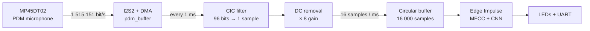

# 🎙️ STM32F407 Keyword Spotting — "go" / "stop"


Offline voice command recognition on an **STM32F4 Discovery** board.
Say **"go"** or **"stop"** — the board hears it with its on-board **MP45DT02 PDM microphone**, runs an **Edge Impulse** neural network on the chip and answers with an LED. No internet, no PC, no cloud.

---

## ✨ Features

- **Register-aware PDM microphone driver** (`mp45dt02.c/.h`) — I2S2 + DMA in circular mode, 4-stage CIC decimation filter, DC removal, gain, self-check at start-up (clock range + bit activity, like a `WHO_AM_I` check)
- **Clock-adaptive** — the driver reads the real I2S divider from `SPI2_I2SPR` and computes the decimation itself (works for any CubeMX audio setting inside the mic's 1–3.25 MHz range)
- **Voice-triggered recording** — press the button once, speak whenever you want; the word is always centred in the 1 s window
- **Circular buffer** for 16 000 PCM samples
- **On-device inference** — MFCC + 1D CNN (Edge Impulse, int8)
- **UART debug output** — class scores and a 10-segment level profile of every recording
- **Data dump mode** (`AI_VERI_TOPLAMA`) — streams raw PCM over UART to inspect or collect training data

## 📊 Results

| Command | Board result | LED |
|---|---|---|
| go | **88.67 %** | 🟢 green |
| stop | **99.61 %** | 🔴 red |
| anything else / below 60 % | — | 🔵 blue |

Model test accuracy in Edge Impulse: **85.17 %** (4 classes: `go`, `stop`, `_noise`, `_unknown`).


---

## 🧭 How it works



### Clock chain

```
HSE 8 MHz ÷ 4 = 2 MHz → PLLI2S × 50 = 100 MHz ÷ 2 = 50 MHz   (I2S input)
50 MHz ÷ 33 = 1 515 151 Hz on PB10                             (microphone clock)
1 515 151 bit/s ÷ 96 bit = 15 783 samples/s ≈ 16 kHz            (model input)
```


### Voice-triggered window

| Step | What happens |
|---|---|
| Button | Orange LED on, listening starts; first **300 ms** ignored (button clicks) |
| Listening | Only the last **300 ms** are kept in the queue |
| Trigger | 1 ms peak level > **2000** for **10 ms** in a row → speech started |
| Recording | **700 ms** more → 1 s window with the word in the middle |
| Timeout | No speech in **3 s** → blue LED |

---

## 🔌 Hardware

| Signal | Pin | Note |
|---|---|---|
| Mic clock (I2S2_CK) | PB10 | 1.515 MHz |
| Mic data (I2S2_SD) | PC3 | PDM bits |
| User button | PA0 | EXTI, rising edge |
| LEDs | PD12 / PD13 / PD14 / PD15 | green / orange / red / blue |
| UART TX (USART2) | PA2 | 115200 8N1 → USB-TTL RX |

> ⚠️ **Do not use USART1 / PA9 on the Discovery board** — PA9 is tied to USB VBUS with a 4.7 µF capacitor (C49), the TX signal cannot toggle.

---

## 📁 Project structure

```
Core/
 ├─ Inc/
 │   ├─ mp45dt02.h          microphone driver: limits, settings, struct
 │   ├─ circular_buffer.h   16 001-slot queue (int16)
 │   └─ ai_controller.h     window size, data-dump switch
 └─ Src/
     ├─ main.c              button, listen/record state machine, UART
     ├─ mp45dt02.c          clock check, DMA start, PDM → PCM
     ├─ circular_buffer.c
     └─ ai_controller.cpp   runs the model, decides, drives LEDs
Middlewares/                Edge Impulse SDK + model (CMSIS-PACK)
Drivers/                    STM32 HAL + CMSIS
keywordspotting.ioc         CubeMX configuration
```

## 🛠️ Build & run

1. Open the project in **STM32CubeIDE**.
2. Project → Properties → C/C++ Build → Settings → MCU Settings → enable **"Use float with printf"**.
3. Build and flash with **Run**.
4. Connect a USB-TTL: **RX → PA2**, **GND → GND**, open a terminal at **115200 8N1**.
5. Press the **blue button**, wait for the orange LED, say **"go"** or **"stop"**.

UART output — first "go", then "stop":

<!-- 📌 RESİM 4 BURAYA: Termite UART çıktısı (uart_cikti.png) -->

---

## 🧪 Lessons learned

| Problem | Cause | Fix |
|---|---|---|
| Microphone silent | 32 kHz setting → 1.02 MHz clock, at the mic's lower limit | 48 kHz setting → 1.515 MHz |
| No UART output | PA9 + C49 capacitor on Discovery | USART2 on PA2 |
| Words clipped | Gain 16 → samples hit 32 767 | Gain 8 (measured) |
| "go" not recognised | Fixed window → word fell at the end and was cut | Voice-triggered, centred window |

## 🚀 Roadmap

- [ ] Send the command wirelessly with **nRF24L01** to an **ESP32** driving a relay / motor
- [ ] Start listening from an **IR remote** instead of the on-board button
- [ ] Deploy the **float32** model for higher margins
- [ ] More words from Speech Commands (`on`, `off`, `up`, `down`)
- [ ] PLLI2S N = 215, R = 4 → sample-rate error from 1.35 % to 0.02 %

## 🙏 Acknowledgements

- [Edge Impulse](https://edgeimpulse.com) — model training and deployment
- [Google Speech Commands dataset](https://arxiv.org/abs/1804.03209) — training data (CC BY 4.0)
- STMicroelectronics — STM32 HAL, RM0090, MP45DT02 datasheet

## 📄 License

Third-party code keeps its own license: STM32 HAL/CMSIS (BSD-3-Clause / Apache-2.0), Edge Impulse SDK (Apache-2.0).

---

<details>
<summary>🇹🇷 Türkçe özet</summary>

**STM32F4 Discovery** üzerinde internetsiz sesli komut tanıma. Kartın kendi **MP45DT02** mikrofonu sesi dinliyor, **Edge Impulse** ile eğitilmiş sinir ağı çip üzerinde çalışıyor ve sonucu LED ile gösteriyor.

- Mavi butona bas → turuncu yanar → **"go"** de → 🟢 yeşil, **"stop"** de → 🔴 kırmızı, anlaşılmazsa 🔵 mavi.
- Mikrofon saati: 50 MHz ÷ 33 = 1,515 MHz; her 96 bit 1 ses sayısı; saniyede ~16.000 ses.
- Kayıt sese göre başlıyor: kelime her zaman 1 saniyenin ortasına düşüyor.
- UART (PA2, 115200) üzerinden yüzdeler ve ses seviyeleri izlenebiliyor.

**Yazar:** Yusuf Kerem Yayla — Sakarya Uygulamalı Bilimler Üniversitesi, Elektrik-Elektronik Mühendisliği

</details>
